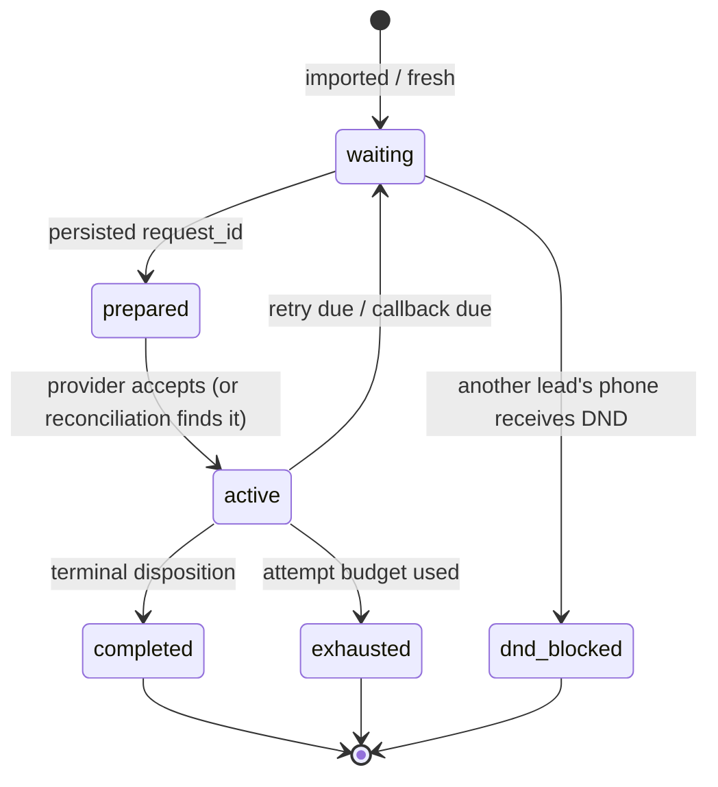

# Submission

> Replace everything in _italics_. Be concise: bullet points are fine. We read every word.

## Candidate
- **Name:** _Fill in before submission_
- **Assignment chosen:** B (Workflow)
- **Time spent (honest estimate):** _Fill in before submission_

## How to run
```bash
python -m venv .venv
# Windows: .venv\Scripts\activate   |   macOS/Linux: source .venv/bin/activate
pip install -r requirements.txt

# terminal 1
cd assignment-b-workflow
python -m mock_telephony

# terminal 2, from repository root
python -m solution

# terminal 3, from repository root
pytest -q
```

## Design
The service combines a FastAPI webhook receiver (port 8200) with one dispatcher loop. SQLite is
the durable state store: it contains leads and an outbound-call intent row. Fixture import is
`INSERT OR IGNORE`, so restarting does not reset progress. All scheduling decisions use the
provider's `/v1/clock`, never the host clock.

Before a network request, the dispatcher commits a UUID `request_id` in `calls` as `prepared`.
On restart, every prepared or accepted intent is looked up by request ID. A missing intent is
posted with the same key; a known one is adopted; an ended one is processed. Thus a crash between
any two lines only causes a safe replay, never a second provider call. A result webhook is proof
that the call was accepted even if it arrives before the POST response.



## Decisions & assumptions
| Decision | Why | Alternative considered |
|---|---|---|
| SQLite state machine | Small, inspectable durable core without an external service | Temporal |
| Do not use the provider's 120-second grace | Starting strictly inside windows is safer than relying on tolerance | Dispatching in the grace period |
| Treat an accepted final callback attempt as exhausted | There is no legal remaining attempt to honour it | Exceeding the configured budget |
| Keep serving after `final_state.csv` is written | Lets the status endpoint be inspected; output is already complete | Exiting automatically |

| Decision | Why | Alternative considered |
|---|---|---|
| _ | _ | _ |

## Failure modes considered
- A 503, network error, or ambiguous 504 preserves the exact prepared request and retries or
  reconciles it; a new request ID is never generated.
- Duplicate webhooks are harmless because an ended call has a persisted `processed` marker.
- Missing webhooks are recovered by polling every prepared/accepted request ID.
- The HMAC is checked against the raw webhook body before any state mutation.
- Process death is safe because intent precedes I/O and startup reconciliation reads the carrier.
- Tenant capacity and active phone checks are derived from durable accepted calls. Callback,
  retry, and fresh work are priority ordered in that order.
- This is intentionally a single dispatcher process. Multi-process leader election / row-level
  leases are not implemented.

## Testing
`pytest -q` tests the isolated window boundaries, next-open calculation, retry intervals, and
priority ordering with fixed datetimes. I also ran the end-to-end mock with failure injection and
inspected `/admin/report` and `/admin/leads`. The repository includes no test that sends real
HTTP calls to an external carrier.

## Results
Fill in the observed `/admin/report` from your final local run before submitting. The expected
target is `violation_count: 0` and a `final_state.csv` matching `/admin/leads`.

## If I had another day
1. Add SQLite leases or Postgres row locking for active/active multi-worker operation.
2. Add metrics/tracing around carrier latency, reconciliation, and callback lateness.
3. Add an end-to-end chaos test which repeatedly kills and restarts the process.
